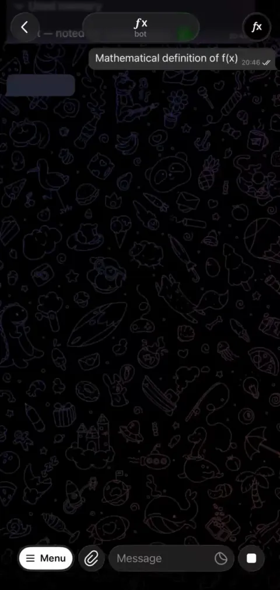
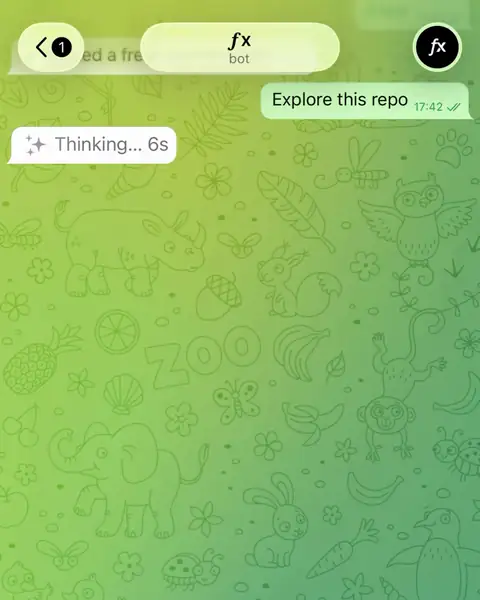
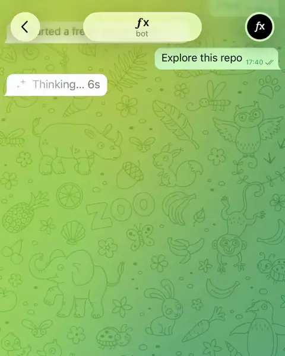
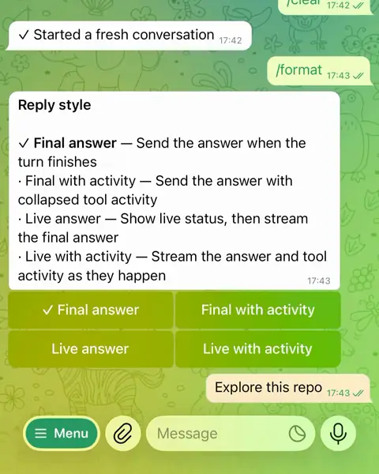
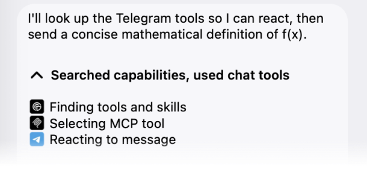

# 𝒕𝒈(𝒇x)

Chat with a Vercel [𝒇x](https://github.com/vercel-labs/fx) coding agent from
Telegram. Works with your locally installed 𝒇x and supports as many of the latest Telegram features as possible.

## Features



Most Telegram adapters for popular harnesses only scratch the surface of what Telegram can do.
Not 𝒕𝒈(𝒇x): the aim is chatting with your agent from Telegram the way you would from its TUI.

- [x] Rich replies: markdown, tables, code blocks, spoilers, TeX math
- [x] Live streaming while the agent works, renders tool calls nicely
- [x] Three reply styles (`/format`), from a quiet final answer to a live draft with tool activity
- [x] Can work in DMs and groups
- [x] Can send stickers and react to messages
- [x] Interactive model picker (`/model`)
- [x] Conversation compaction (`/compact`) and fresh starts (`/clear`), with inline confirmation buttons
- [x] Cost reports (`/cost`)
- [x] Approval cards for destructive actions
- [x] Bots can be group admins: pin messages, moderate, and more
- [x] Custom emoji icons for tool calls and popular MCPs ([see below](#custom-icons))
- [x] The agent can see and send files, images, location pins, polls, **voice messages** and even **video messages**
- [ ] `soon` Talking to [other bots](https://telegram.org/blog/ai-bot-revolution-11-new-features#bot-to-bot-communication)

## Install

You need an authenticated `fx 0.0.15+` and a bot
token from [@BotFather](https://t.me/BotFather).

Install [𝒇x](https://fx.sh) and sign in with `fx login` (Vercel),
`fx login codex` (ChatGPT), or `fx login grok` (Grok):

```bash
# 0. Ensure fx is installed and authenticated
curl -fsSL https://fx.sh/setup.sh | bash
fx login

# 1. Install the package (recommended, macOS and Linux)
curl -fsSL https://raw.githubusercontent.com/molefrog/tgfx/main/scripts/install-release.sh | sh

# 2. Grab a bot token from @BotFather, then run tgfx in your project folder.
#    It walks you through authorization on the first run.
tgfx
```

Or install with **Cargo** (requires Rust and a C compiler):

```bash
cargo install --locked --git https://github.com/molefrog/tgfx.git
```

Set `TELEGRAM_BOT_TOKEN` to override the saved token.

## How it works

That's it. `tgfx` starts an `fx acp` process in that folder, with your current
𝒇x provider and model, and bridges it to your Telegram bot. Pass `--yolo` to
skip 𝒇x's permission checks.

On the first run it asks for your bot token and pairs you as the owner: scan a
QR code or tap a link. To change or remove the token later, run `tgfx auth`.
Everything tgfx remembers about a folder lives under `~/.fx/telegram/`; nothing
is written into the project.

## Persistent memory

When `MEMORY.md` exists in your project, TGFX loads it into the bot's context
and refreshes it before new turns. This gives your assistant shared memory
across chats. You or the bot can update the file.

To turn it off, set `"memory": { "enabled": false }` in the project's TGFX config.

## External events

Your bot can react to things outside Telegram: incoming emails, scheduled
checks, or updates from other apps. Call `tgfx emit` from the project folder
while 𝒕𝒈(𝒇x) is running:

```sh
# Handle a new email in the background
tgfx emit email.received --payload '{"message_id":"123"}'

# Ask for an update in a Telegram chat
tgfx emit daily.check --chat -1001234567890 --prompt "Review today's tasks and send a summary."
```

Use `--chat` to choose where the bot replies. Without it, the bot works in the
background. Events wait their turn if it's busy; add `--steer` to update its
current task instead.

## Groups and reply settings

By default, bots only respond in groups when mentioned or replied to.
To reply to every message, allow the group using its chat ID:

```bash
tgfx allow -1001234567890 --reply all
```

To let it see the whole discussion, make it a group admin, or disable Group
Privacy in [@BotFather](https://t.me/BotFather) (`/setprivacy` → **Disable**),
then remove and re-add it to the group. Keep tgfx running to collect messages
as context for later requests; it cannot fetch messages from before it joined.

## Reply style

𝒕𝒈(𝒇x) has three reply styles, depending on whether you want the answer
streamed and whether you want to see the full history of tool calls.

By default, it streams the text using Telegram's new
[live message drafts](https://telegram.org/blog/ai-bot-revolution-11-new-features#streaming-text-for-bots).
In **Detailed**, tool calls are rendered as collapsible groups, in the order
they happen.

<table>
  <tr>
    <th align="center">Detailed</th>
    <th align="center">Live</th>
    <th align="center">Final</th>
  </tr>
  <tr>
    <td width="240" align="center"></td>
    <td width="240" align="center"></td>
    <td width="240" align="center"></td>
  </tr>
  <tr>
    <td align="center"><code>detailed</code><br>Stream the answer and tool activity as they happen</td>
    <td align="center"><code>live</code> (default)<br>Show live status drafts, then stream the final answer</td>
    <td align="center"><code>final</code><br>Send the answer only when the full turn finishes</td>
  </tr>
</table>

Groups always get one message in **Final**. Changing a chat's style affects new turns.

How to pick a reply style:

- Start 𝒕𝒈(𝒇x) with `--output <mode>` to set the default for one run
- Send `/format` to the bot in a DM and tap a button to save a choice for that chat
- Set a machine-wide default in `~/.fx/telegram/config.json`:

```json
{ "defaults": { "output": "live" } }
```

## Custom icons



The bot renders tool calls nicely with the
[tgfx icons](https://t.me/addemoji/ai_provider_labs_by_fxharness_bot) premium custom
emoji pack: every 𝒇x tool gets its own icon, and so do 100+ popular MCP
servers (GitHub, Notion, Slack, Figma, and friends). The model picker uses
provider logos (OpenAI, Anthropic, etc.) from the same pack.

To turn it off, start with `tgfx --no-icons`.

## MCP

The agent uses Telegram actions, such as reactions and sending stickers,
through the Telegram MCP that 𝒕𝒈(𝒇x) injects.

## Commands

```text
tgfx           run fx in this folder (sets up on first run)
tgfx --yolo    same, without fx permission checks
tgfx --output  final · live · detailed (DM default)
tgfx allow     let more users or chats talk to the bot (no id: pair by QR code)
tgfx auth      add, rotate, or remove the bot token
tgfx doctor    diagnostics: token, chats, rights, fx
```

Run `tgfx --help` for all commands and options.
